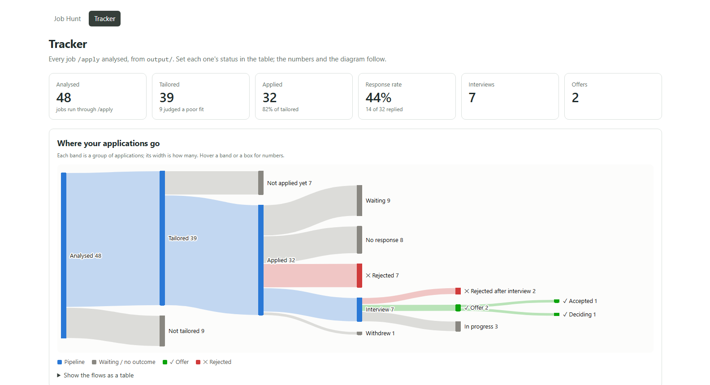

# Job Hunt Tool

A personal job-search assistant that runs on your own computer. It finds postings that match
your CV, ranks them, tailors your CV and cover letter for the ones you pick with Claude Code,
and tracks every application through to an offer.



**[Live demo with sample data](https://abellucido.github.io/demos/job-hunt/)**

## What it does

1. **Search.** `jobscout` queries the public job APIs behind company career sites (Workday,
   Greenhouse, Lever, SmartRecruiters), filters by country and posting date, and scores each
   posting against keywords from your CV. It flags required languages you don't speak, seniority
   mismatches and skill gaps.
2. **Shortlist.** A local web page shows the ranked postings. Tick the ones worth applying to.
3. **Tailor.** For each ticked job, the page runs Claude Code headless with the `/apply` skill:
   it maps the job's requirements to evidence in your CV, rewrites the profile, reorders skills and
   bullets, fills in the cover letter, checks that no date, title or number changed, and compiles
   both to PDF.
4. **Track.** The Tracker page lists every analysed job. Set each one's status (applied, rejected,
   interview, offer…) and a Sankey diagram shows where your applications go.

```
Browser (webapp/static/*.html)
   │
   ▼
webapp/app.py  (FastAPI, localhost only)
   ├─ Search  → python jobscout/jobscout.py …           → jobscout/runs/<run>/
   ├─ Tailor  → claude -p "/apply <job file>"           → output/<date>_<Company>_<Role>/
   └─ Track   → reads output/, saves statuses           → webapp/tracker.json
```

## Design choices

- **Your documents never leave your machine** except to Claude for tailoring. `base/`, `output/`,
  search runs and the tracker are excluded from git by an allow-list `.gitignore`.
- **The model never invents facts.** The skill may only reorder and rephrase what is in your
  master CV, and it diffs the result against the master to confirm no date, title, employer or
  number changed.
- **Polite to career sites.** Requests to each Workday server group are spaced out, and a group
  that starts rate limiting is skipped for the rest of the search instead of being retried hard.
- **Each part runs on its own.** The page only starts the same commands you can run in a terminal,
  which makes every step easy to test and debug.

## Setup

You need Python 3.10+, [Claude Code](https://claude.com/claude-code) (logged in), and a LaTeX
distribution with `pdflatex` and `xelatex`.

```bash
git clone https://github.com/abellucido/job-hunt-tool.git
cd job-hunt-tool
cp -r skills/apply ~/.claude/skills/        # the tailoring skill; adapt it to your documents
# put your cv_master.tex, master.tex and (optional) facts.md in base/ (see base/README.md)
# edit jobscout/config.yaml: countries, keywords from your CV, companies to search
./webapp/start.sh                            # then open http://localhost:8000
```

Tailoring runs Claude Code on your own account and counts against its usage limits.

## Repository layout

| Path | What it is |
|---|---|
| `jobscout/` | Job search and scoring (`jobscout.py`, `config.yaml`); also runs on its own from the command line |
| `webapp/` | Local web app: `app.py` (API), `companies.py`, `tracker.py`, `static/` (pages) |
| `skills/apply/` | Generic version of the Claude Code skill that tailors the documents |
| `base/` | Your master CV and cover letter (not committed) |

More detail on how each part works, and how to change it, is in [`webapp/README.md`](webapp/README.md)
and [`jobscout/README.md`](jobscout/README.md).

## Tech

Python · FastAPI · Claude Code (headless) · LaTeX · d3-sankey · vanilla JavaScript

## License

[MIT](LICENSE)
